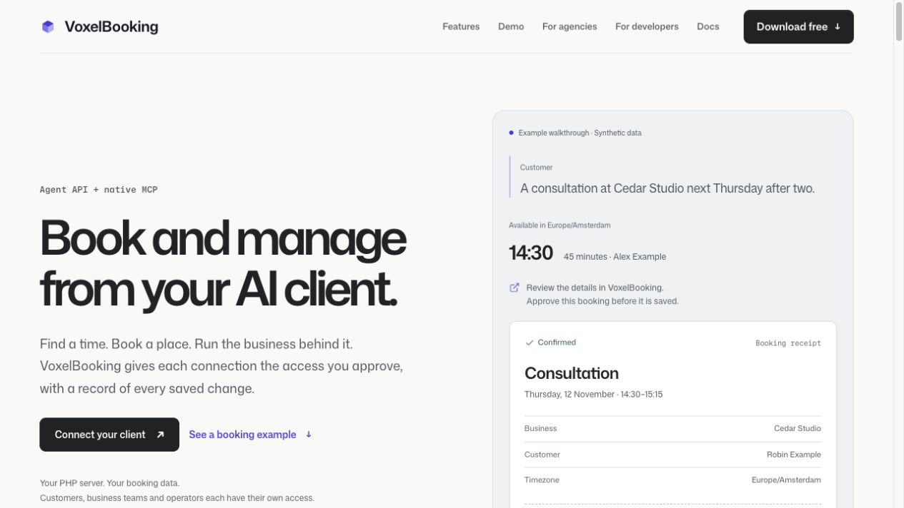
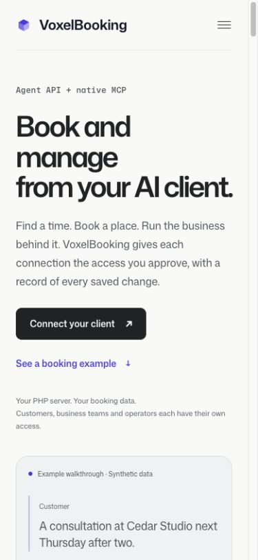
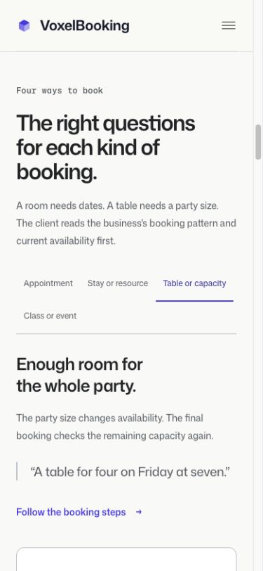
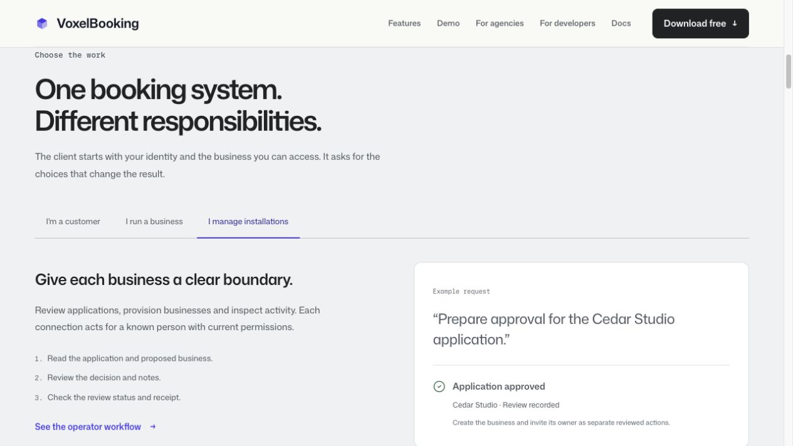
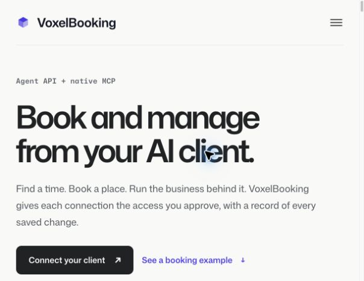
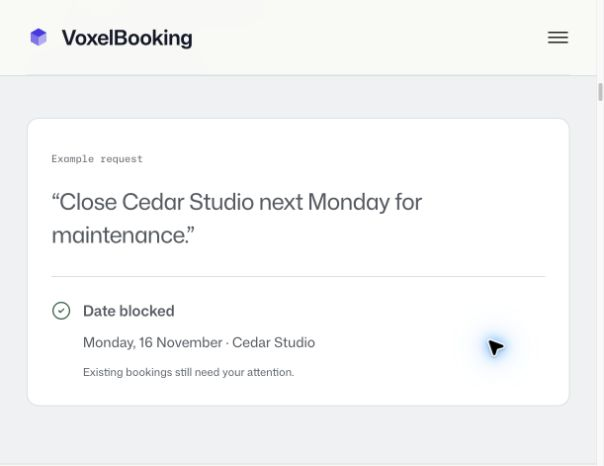
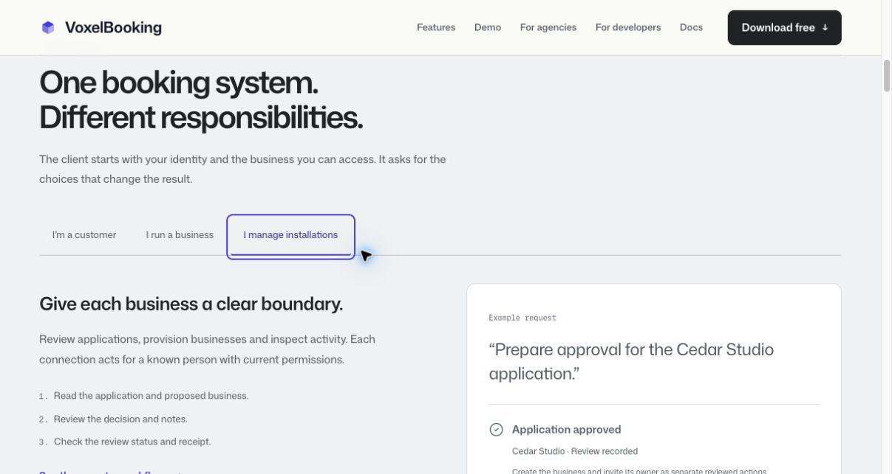

# Agent documentation and marketing verification

The site increment implements the required 24 published Agent API guides, a connection-management admin guide, generated OpenAPI/MCP references, related feature-guide links, discovery facts and the `/agent-api` explanation page. The required Cursor guide remains unpublished because that client has not been tested.

Content follows the site's Rewrite-Unslop Manifest and uses Pepper's agent documentation as a structural reference. Claims describe implemented operations and current authority boundaries. Application approval is explicitly separate from business provisioning and owner invitation. Client claims are limited to the exact tested staff timeslot bearer workflows in [native client evidence](native-client-evidence.md).

## Automated evidence

Commands run in the site checkout on 20 October 2026:

- `php artisan docs:index` — 61 indexed articles.
- `php artisan test --compact tests/Feature/AgentDocumentationTest.php tests/Feature/PublicPageAuditTest.php tests/Feature/TechnicalSeoTest.php tests/Feature/DiscoveryPagesTest.php` — **21 tests, 4014 assertions passed** after the 129-operation export and connection-activity/hosting updates. The final migration-retry guide update was rechecked with the equivalent `--filter='AgentDocumentationTest|PublicPageAuditTest|TechnicalSeoTest|DiscoveryPagesTest'` selection: 21 tests, 4,014 assertions passed, and the 61-article index was rebuilt.
- `node --test tests/JavaScript/agent-examples.test.mjs` — **3 passed**, checking progressive enhancement and keyboard tab behavior.
- `vendor/bin/pint --dirty --format agent` — passed.
- `npm run build` with Node 22.21.1 — passed. Existing missing branded font assets and the Mermaid chunk-size warning remain build warnings; fallback typography was inspected.

The feature checks cover guide ordering and navigation, internal generated operation links, unique HTTP operation bindings, server-rendered example panels, FAQ/structured-data consistency, search and sitemap inclusion. They also execute the exact published PHP webhook verifier against valid, rotated, tampered, expired, duplicate-timestamp and missing-signature requests. Generated assets come from the app registry using `php scripts/export-agent-docs.php <destination>`, without database access.

## Rendered evidence

Inspected in the in-app browser at `https://voxelbooking-site.test/agent-api`:

- Desktop at 1265×712: hero hierarchy, the three actor examples, all four pattern examples, review/receipt presentation and progressive technical detail.
- Mobile at 390×844: hero, booking receipt, pattern selector and documentation navigation/search. No horizontal overflow in the observed 375-pixel content area.
- Compact 640-pixel layout: content reflow and tab access.
- Keyboard: actor/pattern tabs with arrow navigation and Home/End, visible focus, selection and panel state.
- Corrected operator example verified after rendering: application status and receipt, with business creation/invitation separate.

The tab logic supports RTL navigation and keeps all example panels readable before JavaScript enhancement. A separate native Chrome 155.0.8059.84 check set the browser zoom control to **200%**: device-pixel ratio was 2, viewport width 611 pixels, document scroll width 603 pixels, and both tablists measured 550 pixels with no horizontal overflow. The business example and receipt were inspected at that zoom.

Chrome DevTools emulated `prefers-reduced-motion: reduce`; `matchMedia` returned true and the tab transition computed to .00001 seconds. ArrowRight moved from the business tab to the operator tab and displayed its corresponding panel. The reviewer restored default motion and 100% zoom afterward. This verifies browser reduced-motion emulation, not an operating-system preference panel.

Saved screenshots:

