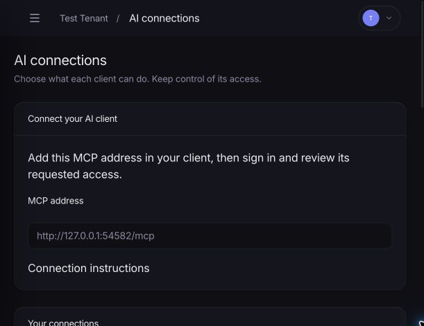
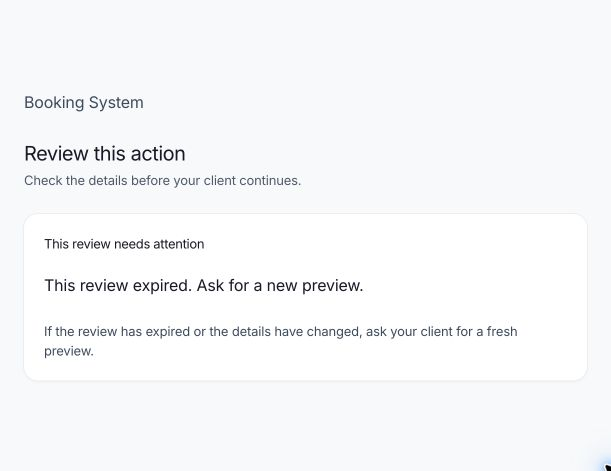
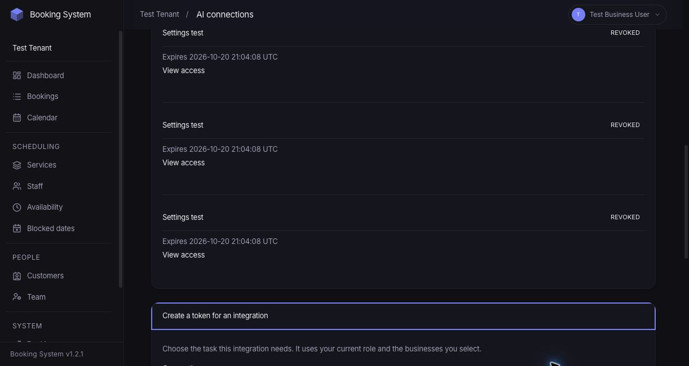
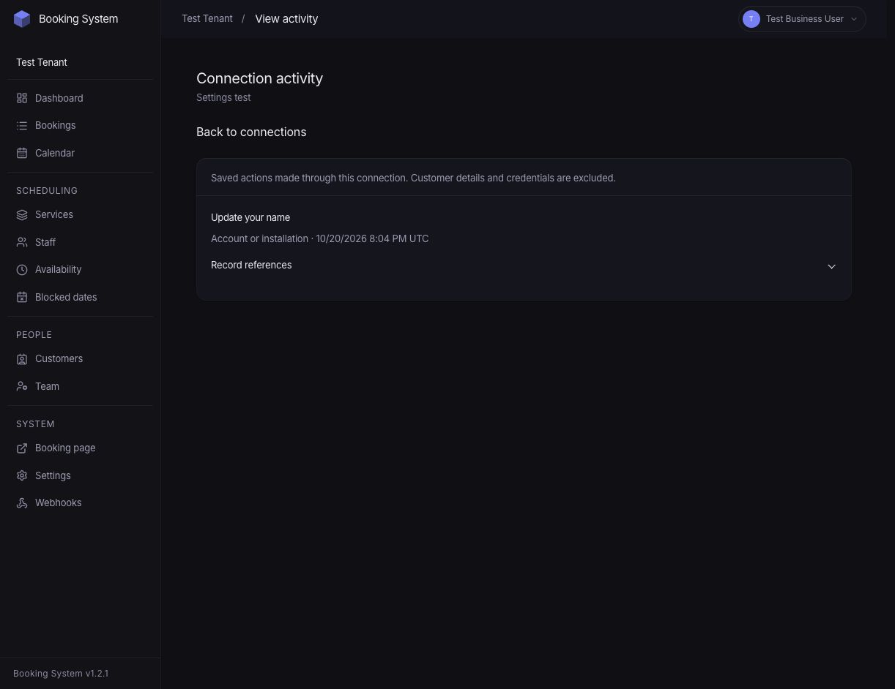
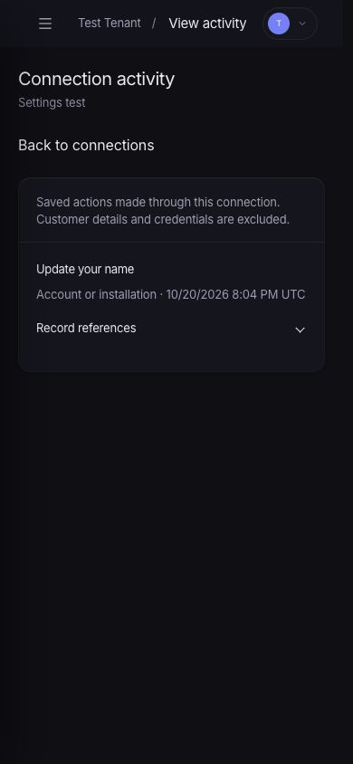

# Agent API and native MCP release evidence

Evidence date: 20 October 2026. [Release notes and upgrade procedure](release-notes.md). This report links the implementation acceptance contract to executable checks. The [action-level parity ledger](parity-ledger.md) records 42 capability groups, 190 human route registrations and 129 registered application operations. These are different inventories: reviewed commands also expose preview tools, and trusted-browser actions are explicit parity decisions.

The [operation success inventory](evidence/operation-success-contracts.json) maps every registered operation to a real successful Executor test. Its transport fields distinguish direct Executor, native MCP serialization and actual HTTP requests. A successful schema execution does not establish every role, pattern, failure combination or branded client integration.

## Reproduce without touching application data

Run from the application checkout:

```sh
php scripts/test-isolated.php
php scripts/test-isolated.php --upgrade-check --mysql-image=mysql:8.0
vendor/bin/phpunit --no-configuration --bootstrap vendor/autoload.php \
  --no-coverage tests/Unit/Agent/Mcp tests/Unit/Agent/OAuth
mkdir -p /tmp/voxelbooking-agent-contracts
php scripts/export-agent-docs.php /tmp/voxelbooking-agent-contracts
```

The isolated runner creates a private copied application, uniquely named disposable MySQL database, manifest and four-worker HTTP server. The test bootstrap refuses an ordinary database. Docker is a test dependency, not a hosting requirement. Do not run the ordinary test configuration against development or production credentials. The [test-environment and upgrade report](evidence/test-environment.md) records guard checks and migration recovery details.

For a focused regression, pass PHPUnit arguments after the runner command, for example `php scripts/test-isolated.php --filter MediaUploadRecoveryTest`. `--keep --serve` retains a disposable server for browser/client verification; stop that runner when finished. Keep generated credentials and raw client logs private.

The baseline revisions are application `5ba99941c3c296716e7c9b7d49e3cb666de0d064` and site `ad0e67f4b77b1f84a3ee0610ed792f3c8a298f67`, and the 1.3.0 release is the `main` branch of each repository after those revisions. The matrix [results](evidence/matrix/results.json) record the Git tree of every tested source directory. The final [source manifest](evidence/source-manifest.json) fingerprints source, tests, configuration, compiled assets and lockfiles without runtime secrets or evidence self-cycles. Reproduce with `python3 scripts/release-source-manifest.py --site ../voxelbooking-site --output /tmp/voxelbooking-source-manifest.json` and compare its file hashes.

## Recorded runs

| Check | Recorded result |
| --- | --- |
| Complete matrix: PHP 8.3.32 / MySQL 8.0.46 | **1,974 tests, 29,225 assertions passed**; zero failures, errors, skips, warnings or deprecations; exit 0 |
| Complete matrix: PHP 8.5.10 / MySQL 8.4.11 | **1,974 tests, 29,225 assertions passed**; zero failures, errors, skips, warnings or deprecations; exit 0 |
| Pure MCP/OAuth adapter suite | 86 tests, 270 assertions; PHP 8.5.7 |
| Catalog/business/system operation success contracts | 9 tests, 634 assertions; PHP 8.5.7/MySQL 8.4.11 |
| Booking/customer/privacy success contracts and related regressions | 54 tests, 1,287 assertions; subsequent privacy-lock and complete-contract run 14 tests, 1,053 assertions; final creation/reschedule policy, delivery, DST and retained-authority follow-up 27 tests, 1,361 assertions; PHP 8.5.7/MySQL 8.4.11 |
| Reviewed catalog/business/system regressions | 56 tests, 179 assertions; PHP 8.5.10/MySQL 8.4.11 |
| Combined timeslot/capacity browser, HTTP and MCP acceptance | 2 tests, 494 assertions; PHP 8.5.7/MySQL 8.4.11 |
| OAuth/media recovery integration | 18 tests, 112 assertions; PHP 8.5.7/MySQL 8.4.11 |
| Settings/identity/activity and reviewed recovery checks | Final focused run: 21 tests, 242 assertions; no warnings or deprecations |
| Webhook/media/receipt and related contract checks | Earlier combined focused run: 22 tests, 220 assertions; final runtime matrix includes all later changes |
| Git migration retry and stable lock | 3 pure tests, 76 assertions; native pending-schema retry form 1 test, 8 assertions; PHP 8.5.7/MySQL 8.4.11 |
| Upgrade rehearsal | Actual version-28 database to migration 42, committed-DDL replay, partial-column recovery, failed-migration retry and backup restore; PHP 8.3.32/MySQL 8.0.46, PHP 8.3.32/MySQL 8.4.11 and PHP 8.5.10/MySQL 8.4.11 ([logs](evidence/matrix/README.md)) |
| Transport success evidence | All 132 operations succeed over HTTP v2 and native MCP over the wire; the [parity ledger](parity-ledger.md) names each test method and CI requires each one to run and pass |
| Documentation/marketing | 35 tests, 11,065 assertions; 30 JavaScript tests; 61 indexed guides; production asset build passed; homepage CLS 0 at 390 px and 1440 px |
| Installed native clients | Codex CLI 0.153.4 and Claude Code 2.1.281: scoped staff bearer timeslot workflow passed |

Both complete matrices ran on the 1.3.0 source. Their [retained results](evidence/matrix/results.json), [reproduction record](evidence/matrix/README.md), [PHP 8.3/MySQL 8.0 log](evidence/matrix/php83-mysql80.log) and [PHP 8.5/MySQL 8.4 log](evidence/matrix/php85-mysql84.log) describe the exact final run. The first 1.3.0 matrix exposed a calendar stamp that followed the clock and an upgrade probe that collided with migration 042; both were fixed and the matrix rerun. Focused runs are not added together because suites overlap.

## Acceptance scenarios

Each test reference below is a concrete method unless a whole class contains the necessary data-provider cases. “Covered” identifies executable evidence, not a blanket certification of every possible client environment. The separate limits column is part of the result.

| ID | Scenario | Executable evidence | Result and limits |
| --- | --- | --- | --- |
| A01 | IDs do not grant public management/privacy authority | `CustomerCapabilityBoundaryTest::testIdentifiersAndForgedOriginNeverAuthorizePublicManagement` | Covered: identifiers and a forged Origin cannot replace independent proof. |
| A02 | Cross-business selectors and cursors | `AuthorizationPolicyTest::testOwnerCannotEscapeBusinessWithNestedSelectors`; `CatalogOperationsTest::testAssignedRecordsMustBelongToBusiness`; `CustomerApplicationOperationsTest::testPrivacyHistoryAndExportExcludeForeignBookingRelationsAndPageConsents` | Covered across policy, nested catalog relations, privacy and cursor boundaries. |
| A03 | Role changes after token issuance | `AgentFoundationTest::testRevocationRoleChangesIdentityChangesAndAudienceTakeEffect`; `BusinessOperationsTest::testTeamStateChangeUsesCurrentRoleEvenWithOldOwnerContext` | Covered: current role overrides old token authority. |
| A04 | Revoked/deactivated/archived authority | `BookingDirectAuthorizationTest::testRetainedBearerCannotReadPreviewOrMutateAfterRevocation`; `CatalogOperationsTest::testWaitingCatalogTeamAndSettingsWritersRecheckIdentity`; `OAuthIntegrationTest::testTokenExchangeDoesNotUseIdentitySnapshotFromBeforeConcurrentDeactivation` | Covered, including a writer blocked on a business lock and token issuance after concurrent deactivation. |
| A05 | Legacy dormant write scopes | `LegacyCredentialTest::testDormantWriteScopesNeverBecomeEffective`; `scripts/test-upgrade.php` | Covered by unit checks and an actual version-28 upgrade. |
| A06 | OAuth redirect/resource/PKCE/replay | `AuthorizationServerTest::testPkceS256AndExactRegisteredRedirectAreRequired`, `testResourceAndRedirectMismatchCannotIssueTokens`, `testCodeCanOnlyBeRedeemedOnce`, `testRefreshRotationNarrowsScopesAndReuseRevokesConnection`; `OAuthHttpTest::testDuplicateParametersAndInvalidPkceFailBeforeConsent` | Covered with the maintained League server and real HTTP authorization flow; branded-client OAuth remains unverified. |
| A07 | Anonymous email/ID knowledge | `CustomerCapabilityBoundaryTest::testRecoveryReturnsIdenticalResponsesAndQueuesNoRawCapability`; `SharedBookingOperationsTest::testUnverifiedBookingCannotOverwriteAnExistingCustomerProfile` | Covered: generic recovery responses and no profile overwrite based on email knowledge. |
| A08 | Booking grant used for privacy/another booking | `CustomerApplicationOperationsTest::testManageGrantCannotAccessPrivacyOperation`; `SharedBookingOperationsTest::testVerifiedBookingActorCannotCancelAnotherBooking` | Covered; independent privacy verification remains required. |
| A09 | Concurrent quota and rotating IPs | `AgentAdmissionRecoveryTest::testConcurrentCredentialAdmissionCannotExceedFixedWindow`, `testExhaustedCredentialReturnsHttp429AcrossForwardedAddresses` | Covered with concurrent processes and actual HTTP 429 responses. |
| A10 | Limiter storage failure | `AgentAdmissionRecoveryTest::testLimiterStorageFailureReturnsControlledHttpFailureBeforeMutation` | Covered: controlled 503 before mutation. |
| A11 | Last inventory race in all four patterns | `BookingConcurrencyTest::testLastInventoryHasOneWinnerAcrossEveryPattern` | Covered with concurrent writers per pattern. |
| A12 | Inventory restoration and promotion | `BookingConcurrencyTest::testEveryRestorationRechecksAllPatternInventory`, `testRestorationRejectsInactiveCatalogAndRemovedEventOccurrences`; `SharedBookingOperationsTest::testEventPromotionRechecksInventoryAndPreservesWaitlistedState` | Covered: occupied inventory rejects restoration without changing the previous state. |
| A13 | Lost create response, identical retry | `AgentFoundationTest::testSameIdempotencyKeyCommitsOneRecordAndReturnsSameReceipt`; `BookingOperationContractCoverageTest::testPublishedAppointmentExampleSessionPreviewReviewCommitAndRetry` | Covered: same result/receipt; native-client lifecycle also checks notification-intent counts. |
| A14 | Changed payload or simultaneous identical key | `AgentFoundationTest::testSameIdempotencyKeyCommitsOneRecordAndReturnsSameReceipt`; `AgentAdmissionRecoveryTest::testSimultaneousIdenticalCommandsHaveOneReceiptAndExpiredReplayCannotRepeat` | Covered: changed payload conflicts; concurrent identical calls share one committed result. |
| A15 | Expired replay window and recovery | `AgentAdmissionRecoveryTest::testSimultaneousIdenticalCommandsHaveOneReceiptAndExpiredReplayCannotRepeat`; `BookingOperationContractCoverageTest::testAllFourPatternsAndEveryBookingDiscoveryAndCustomerOperationHaveSuccessfulContracts` | Covered: recovery reports prior commit, including after deletion scrubs replay data. |
| A16 | Expired/changed preview | `SettingsIdentityOperationsTest::testExpiredOrChangedReviewedSettingsCannotCommitOrCreateReceipt`; `BookingOperationContractCoverageTest::testApprovedCreationPreviewRejectsChangedPriceOrCancellationPolicy`, `testApprovedRescheduleRejectsPermissivePolicyChangeWithoutMovingBooking`; `SharedBookingOperationsTest::testNativeCustomerRescheduleRetryReturnsSameReceiptAfterGrantMoves` | Covered: expiry, record changes, six creation price/policy cases and two reschedule deadline cases. Changed policy rejects the old review without moving inventory, grants, notices or receipts; a fresh review exposes the replacement deadline and succeeds. |
| A17 | Failed/competing reschedule | `BookingConcurrencyTest::testDatabaseFailureAfterOriginalLockRollsBackEntireMove`, `testConcurrentMovesProduceOneReplacementAndKeepHistory`; `ReschedulePatternTest::test_event_reschedule_rejects_when_waitlisted` | Covered: original survives failures and no silent waitlist downgrade. |
| A18 | Reschedule history, occupancy and consent | `RescheduleAvailabilityTest::test_only_the_new_timeslot_in_a_reschedule_chain_consumes_inventory`; `SharedBookingOperationsTest::testFourPatternsShareCreationSnapshotsAndConsentRules`; `SelfServiceRescheduleTest::test_reschedule_admin_booking_does_not_fabricate_consent` | Covered with legacy occupancy and absent-consent cases. |
| A19 | Repeated cancellation | `BookingConcurrencyTest::testSimultaneousCancelHasOneLogicalNotificationAndCounterChange`; `SharedBookingOperationsTest::testCancellationJoinsTransactionAndDoesNotDoubleDecrement` | Covered; both installed CLI runs also replay cancellation without an extra receipt/intent. |
| A20 | Email failure after commit | `BookingOperationContractCoverageTest::testCommittedBookingSurvivesProviderFailureAndRetriesOneNoticePerAudience`; `SystemOperationsTest::testReminderRetriesKeepOneLogicalDeliveryAndStableMessageIdentity` | Covered: committed booking and queued receipt survive failure; retry delivers once per audience in the sink with stable Message-ID; idempotent replay creates no extra effect. Live provider delivery is unverified. |
| A21 | Timeslot overrides, buffers, blocks and deadline | `AvailabilityAcceptanceTest::testTimeslotOverridesBuffersBlocksAndDeadlineHaveIdenticalOptionsAndOutcome`; `CatalogOperationsTest::testStaffOverrideClosedWeekdayDoesNotInheritBusinessHours` | Covered through actual browser/API/MCP reads and writes: staff override, two-sided buffer, staff/global blocks, advance deadline, exact stored time/staff/price and rejected stale slot. |
| A22 | Resource DST and seasonal-price boundary | `BookingOperationContractCoverageTest::testResourceStayCrossesDaylightSavingAndSeasonalPriceBoundary` | Covered for spring and autumn: three local nights span 71/73 elapsed hours; nightly rates 50.25 + 70.35 + 70.35 total 190.95 EUR; local/UTC persistence and read contracts agree. |
| A23 | Capacity party boundaries | `AvailabilityAcceptanceTest::testCapacityMinimumMaximumAdjacentBoundariesAndRemainingArithmeticMatchAllTransports` | Covered through actual browser/API/MCP reads and writes: min−1, min, max, max+1; two valid parties fill the exact capacity, and the next request conflicts without another row. |
| A24 | Event recurrence, overnight, full and waitlist | `EventCalculatorTest::upcoming_events_expands_recurring`, `check_availability_waitlist_full`; `RescheduleAvailabilityTest::test_event_occurrence_utc_uses_full_overnight_end_date`; `EventBookingFlowTest::testPublicEventWaitlistBooking` | Covered across recurrence, overnight instants and waitlist rules. |
| A25 | Spring gap and autumn repeated time | `RescheduleAvailabilityTest::test_nonexistent_spring_starts_do_not_produce_slots_or_monthly_dates`, `test_events_preserve_configured_end_clock_and_calendar_day_offset_across_fall_back`; `PublicBookingUtcContractTest::test_create_manage_and_reschedule_share_php_instants_from_persisted_wall_values` | Covered: canonical PHP instant and explicit ambiguity policy are shared with the browser. |
| A26 | Virtual appointment/customer timezone | `TimezoneBookingTest::testCustomerTimezoneDoesNotAlterStoredTime`, `testValidCustomerTimezoneIsPersisted`; `PublicBookingMetadataTest::test_managed_booking_includes_boolean_service_virtuality`; `PublicBookingUtcContractTest` | Covered: stored instant, saved customer timezone and scoped virtuality metadata. |
| A27 | Custom answers and consent | `SharedBookingOperationsTest::testRequiredCustomAnswersAreValidatedBeforeCreatingCustomer`; `SelfServiceRescheduleTest::test_reschedule_admin_booking_does_not_fabricate_consent`; `ConsentRecordingTest::testRecordConsentDoesNotOverwrite` | Covered: validation precedes customer creation; no invented historical consent. |
| A28 | Reorder/deactivate catalog | `CatalogOperationsTest::testReorderCannotCrossActiveState`, `testListCursorDoesNotDuplicateAfterReorderAndRejectsOtherBusiness`, `testCapacityEditsAndDeletePreserveOccupiedWindowsIncludingLegacyReservations` | Covered: stable traversal and occupied-history preservation. |
| A29 | Hours/block impact | `CatalogOperationsTest::testBlockPreviewShowsExistingBookingsWithoutCancellingThem`, `testSchedulePreviewCountsExistingBookingsAndDoesNotWrite` | Covered: impact projection without implicit cancellation. |
| A30 | Application approval versus provisioning | `BusinessOperationsTest::testApplicationApprovalDoesNotProvisionBusiness`; `OperationContractCoverageTest::testEveryBusinessAndTeamActionUsesPublishedContractsWithoutImplicitProvisioning` | Covered and reflected in the rendered operator example. |
| A31 | Manager elevation attempt | `AuthorizationPolicyTest::testManagerCannotUseOwnerScopesEvenWhenGrantNamesThem`; `CatalogOperationsTest::testManagerCannotManageCatalogEvenWithManageScope`; `SettingsIdentityOperationsTest::testSharedWritesRecheckScopesWithoutTransportPolicy` | Covered: named scopes cannot increase current-role authority. |
| A32 | Team invite/access changes | `BusinessOperationsTest::testRegistrySchemasAndReplayReturnOneBusinessAndInvitation`, `testInvitationsMintOnlyWhenDeliveredAndUseWorkingBrowserRoute`, `testTeamCannotDeactivateLastOwner` | Covered: current role, last-owner protection and retry-safe invitation delivery. |
| A33 | Bounded image upload | `MediaGrantSecurityTest::testMediaIsBoundToSourceConnectionAndRevocation`; `MediaUploadRecoveryTest::testActualMultipartUploadAndIdenticalRetryClearCommittedJournal`, `testLostCommitAcknowledgmentPreservesCommittedAndAttachedFiles`; `ImageUploadTest` | Grant/type/size/sanitization and durable filesystem/database recovery covered; no arbitrary path input. |
| A34 | Templates/embed/defaults | `SettingsIdentityOperationsTest::testEverySettingsSectionUsesStrictContractsVersionAndReplay`, `testAllEmailOverridesDefaultsAndSyntheticSamplesUseSharedContracts`; `SettingsValidationTest::testEmbedRejectsPathsAndWildcardDomains`, `testPrivacyPolicyCannotCarryAnExecutableUrl` | Covered: all seven settings sections and email operations have successful contracts and strict validation. |
| A35 | Privacy/export/deletion and operator decision | `DeletionApplicationTest::testDeletionPreviewBindsExactDataAndRevokesCustomerAuthority`; `CustomerApplicationOperationsTest::testPrivacyCommandsRequireIndependentGrantAndQueueAcknowledgmentOnce`; `PrivacyPostLockAuthorizationTest` | Covered, including scope changes while each privacy writer waits for its lock. |
| A36 | Audit/log/export scope and minimization | `SystemOperationsTest::testAuditProjectionDoesNotLeakDetailsOrCrossBusiness`; `CustomerDirectoryOperationsTest::testDirectoryProjectsOperationalFieldsWithoutConsentOrAuthority`; `OperationContractCoverageTest::testAllOperatorSystemActionsUsePublishedNonsecretSuccessContracts` | Covered: scoped projections exclude credential/secret fields. |
| A37 | Overlapping cron and recovery | `SystemOperationsTest::testMaintenanceLockPreventsOverlapAndRecoversAfterRelease`, `testInterruptedWorkerRetainsCompletedSteps`, `testReminderRetriesKeepOneLogicalDeliveryAndStableMessageIdentity` | Covered: installation lock, retained completed steps and stable delivery identity. |
| A38 | Installation/update/credential handoff | `OperationContractCoverageTest::testAllOperatorSystemActionsUsePublishedNonsecretSuccessContracts`; `SystemOperationsTest::testSettingsRedactSecretsAndRejectSecretApiFields`; `SettingsIdentityOperationsTest::testTemporaryPasswordCannotEstablishDelegationEvenWithStaleSession` | Covered: status and bounded browser handoffs; no secret retrieval or arbitrary agent execution. |
| A39 | Webhook failure/retry/signature/DNS | `WebhookOperationsTest::testFailureRetryPreservesEventAndExactSignedBodyWithoutPrivateFields`, `testOutboxRecoveryAndManualRetryAreBounded`; `WebhookSecurityTest::testEachDeliveryResolvesAgainAndRejectsRebinding`; site `AgentDocumentationTest` | Signed bytes, bounded retry, rotating secret, SSRF/DNS and exact published verifier covered. A live external receiver has not been verified. |
| A40 | Stable cursor traversal | `SharedBookingReadTest::testPublicCatalogCursorSupportsNewAnonymousRequestsAndRejectsChangedKind`; `CatalogOperationsTest::testListCursorDoesNotDuplicateAfterReorderAndRejectsOtherBusiness`; `DeletionApplicationTest::testQueueCursorIsStableAndBoundToStateAndBusiness` | Covered for independent anonymous requests, edits/reorder, query and business boundaries. |
| A41 | Real success/error contracts | [129-operation success inventory](evidence/operation-success-contracts.json); `HttpTransportTest::testApplicationFailureIsActionableToolResultWithoutBreakingOutputSchema`; `ContractValidationTest` | Every base operation has a successful Executor contract reference. Error-envelope and strict-input cases are tested separately; this is not an exhaustive list of all possible application errors. |
| A42 | Modern MCP protocol | `HttpTransportTest::testModernDiscoveryWorksWithoutHandshakeOrSession`, `testModernHeaderValidationRunsBeforeExecution`, `testMalformedMessagesNeverReachOperations`; `OAuthHttpTest::testRealBrowserConsentPkceAndNativeMcp` | Revision 2026-07-28 adapter and real HTTP evidence. No external certification claim. |
| A43 | Supported legacy protocol | `HttpTransportTest::testLegacyHandshakeHasLegacyShapeAndNegotiatesSupportedVersion`, `testLegacyToolCallRemainsStatelessAndHasTextFallback` | Revision 2025-11-25 adapter evidence; branded clients' negotiated revisions were not captured. |
| A44 | No optional rich-client capabilities | `HttpTransportTest::testLegacyToolCallRemainsStatelessAndHasTextFallback`, `testResourcesAndPromptsAdvertiseOnlyConfiguredCapabilities`; [native-client report](evidence/native-client-evidence.md) | Complete plain-tool/text and browser-review lifecycle demonstrated; Apps/tasks/sampling are not advertised. |
| A45 | Untrusted instructions in content | `AuthorizationPolicyTest`; `SettingsValidationTest::testSettingsChangesCannotSmuggleAuthorityOrPaths`; `HttpTransportTest::testUnexpectedFailureDoesNotLeakExceptionOrInput` | Backend authority depends on resolved actor and schema, never note text. These tests do not certify an AI model's resistance to prompt injection. |
| A46 | Demo through transports/jobs | `BookingDemoParityTest::testDemoWritesUseSharedRulesAndNativeReviewWhileNotificationsStaySuppressed`; `SystemOperationsTest::testDemoReminderIntentCannotEscapeAfterDemoModeChanges`; `DemoSchemaParityTest::testFictionalSqliteArtifactMirrorsMigratedMysqlColumns` | Covered: demo operations use shared rules and outbound effects remain suppressed. |
| A47 | UI/API/MCP equivalent actions | `BookingOperationContractCoverageTest::testAllFourPatternsAndEveryBookingDiscoveryAndCustomerOperationHaveSuccessfulContracts`; `OperationContractCoverageTest`; `SettingsIdentityOperationsTest::testHttpAndMcpReadSameSettingsAndCredentialBudgetSurvivesIpMiddleware`; legacy UI integration suites | Shared services and result/state assertions cover all four patterns and domain families. Per-operation transport evidence is explicit in the success inventory. |
| A48 | Advertised client lifecycle | [Codex CLI/Claude Code native-client report](evidence/native-client-evidence.md), [sanitized results](evidence/native-clients/results.json) | Passed connect/read/create/reschedule/cancel/retry/revoke for the exact staff timeslot bearer combination. All other client combinations are unpublished/unverified. |
| A49 | Keyboard/motion/mobile/zoom/recovery | [Rendered site evidence](evidence/site-evidence.md); staff consent inspection; native Chrome connection/review screenshots below | 390-pixel mobile, keyboard, actual 200% zoom and reduced-motion emulation verified for staff/site surfaces. One customer relative-URL browser inspection remains subject to the tool approval restriction. |
| A50 | Executable public examples | `BookingOperationContractCoverageTest::testPublishedAppointmentExampleSessionPreviewReviewCommitAndRetry`; site `AgentDocumentationTest`; [native-client reproduction helpers](evidence/native-clients/) | Published HTTP session/preview/review/commit/retry and PHP webhook verifier executed. Exact installed-client configuration was exercised; other branded OAuth examples remain explicitly unverified. |
| A51 | New unmapped human action | `ParityLedgerTest::testAddingAnUnmappedUiActionFailsTheGate`, `testEveryHumanActionAndOperationHasAnExplicitDecision`, `testEveryRouteCompilesTogetherWithoutShadowing` | Covered by the CI parity gate and injected unmapped-action regression. |
| A52 | Upgrade/recovery of old credentials/links | `scripts/test-upgrade.php`; `GitUpdaterTest`; `UpdateRecoveryUiTest::testPendingDatabaseUpdateShowsNativeRetryFormWithCsrf`; `LegacyCredentialTest::testDormantWriteScopesNeverBecomeEffective`; `CustomerCapabilityBoundaryTest::testIdentifiersAndForgedOriginNeverAuthorizePublicManagement` | Native retry after a code-current/schema-pending failure and stable updater lock covered. Actual v28→41 upgrade, legacy limiter mismatch, partial DDL resume, injected failure/retry and synthetic backup restore/re-upgrade. Old IDs are not authority; recovery issues independent proof. |

Test files are under [`tests/Integration`](../../tests/Integration), [`tests/Unit/Agent`](../../tests/Unit/Agent), [`tests/Unit/Engine`](../../tests/Unit/Engine) and [`tests/Unit`](../../tests/Unit). The documentation test lives in the site repository at `tests/Feature/AgentDocumentationTest.php`.

## Independent review and operational recovery

The [independent catalog/business/system review](evidence/authorization-review.md) records reproduced failures and fixes for retained credentials, occupied capacity edits, stale transaction snapshots and authority changes while waiting for a lock. The booking implementation received [separate review by the catalog/test-harness owner](evidence/shared-domain-evidence.md), including current catalog/occurrence checks on restoration, scoped related-name joins, retained actors, calendar overlaps and privacy scope changes during lock waits. These are scoped code reviews, not third-party security certification.

The root implementation owner independently reviewed the protocol agent's upload recovery changes and found no blocking issue. Uploads now persist a restricted filesystem journal before moving a sanitized image. Successful commits remove the journal; an uncertain acknowledgment preserves it. Cleanup acquires the business lock, reads durable grant/attachment state, keeps committed files and removes only uncommitted files. Database unavailability defers cleanup. `MediaUploadRecoveryTest` exercises rollback, lost acknowledgment, attached-file preservation, database outage, active writers, process exit and real multipart retry.

The OAuth concurrent-deactivation regression first failed, then passed with READ COMMITTED selected before the League transaction begins. Code/token locking, single-use authorization codes, refresh rotation and connection revalidation remain in force.

Preserve database backups, `storage/keys/`, `storage/media-journal/` and uploaded media coherently. Keep these storage locations writable by the intended PHP process and protected from public access. Do not delete uncertain journals to “fix” a failed upload: cron reconciliation is designed to determine the durable outcome.

The Git updater recovery review reproduced two failures: a code-current retry skipped pending migrations, and the UI hid its retry action. The fix runs the migration callback under the existing update guards, exposes a localized pending-schema retry and preserves failure reporting. A separate reproduced lock regression now retains one stable lock inode. Pure local-repository and disposable native-form tests pass; the test-harness owner independently reviewed the patch.

## Rendered staff evidence

Native Chrome 155.0.8059.84 displayed connections and an expired review at actual 200% zoom: device-pixel ratio 2, viewport/scroll width 611 pixels. Reduced-motion emulation matched the media query, reduced transitions to .00001 seconds and preserved Space/Enter disclosure behavior. The reviewer restored 100% zoom and normal emulation afterward.







The connection activity page was also inspected at desktop and mobile sizes after the disclosure affordance was finalized.





## Explicit external and unverified boundaries

- Codex CLI 0.153.4 and Claude Code 2.1.281 passed the staff timeslot bearer workflow. Their negotiated protocol revision was not captured. Branded OAuth login, public/customer workflows, resource/capacity/event workflows in those clients, hosted ChatGPT/Claude, VS Code and Cursor have not been verified.
- Automated OAuth tests cover staff and independently verified customer browser consent. A reachable production HTTPS endpoint and the target client's account/configuration are needed to verify hosted-client OAuth.
- Durable mail and webhook effects were checked with controlled fixtures/sinks and failure injection. Live production mail-provider delivery and an external webhook receiver were not verified.
- The marketing page's examples are labeled simulations. They make no booking and send no message.
- The customer relative-URL visual check was rejected by automatic tool approval; no workaround was used. Other staff/site browser checks proceeded independently.

The final runtime matrix and action-level ledger are verified for the recorded source. The external and visual boundaries above remain part of the release record; no broader client compatibility or live-delivery claim is implied.
